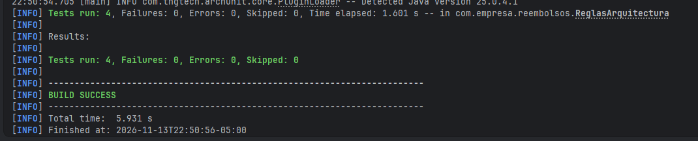
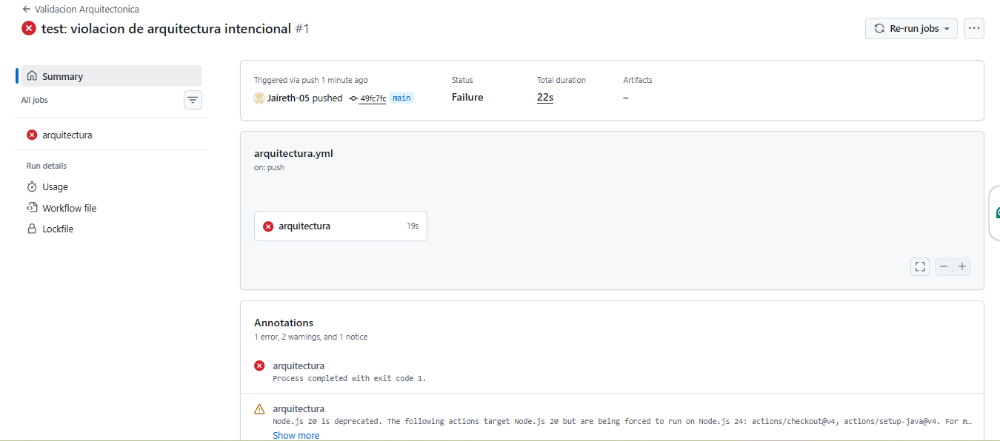

# Sistema de Solicitudes de Reembolso de Gastos Corporativos

Proyecto integrador · Unidad 12 · Patrones de Diseño de Software


## Tecnologías

- Java 17
- Spring Boot 3.x (Spring Web, Spring Data JPA)
- H2 (base de datos en memoria)
- Maven
- ArchUnit 1.x (tests de arquitectura, scope test)
## Contexto del problema

Los empleados registran una solicitud con categoría del gasto, monto y fecha, y adjuntan documentos soporte. El sistema debe cumplir tres requisitos funcionales:

- **RF1.** Validación en varias etapas antes de aprobar (tope por categoría, documentos soporte, sin duplicados pendientes), con nuevas verificaciones previstas a futuro.
- **RF2.** Cálculo del monto aprobado con fórmula distinta por categoría (viáticos, representación, capacitación), con nuevas categorías previstas.
- **RF3.** Notificación simultánea a varios interesados (empleado, Contabilidad, auditoría) ante cada cambio de estado, con más interesados previstos.
## Diseño Propuesto

Análisis realizado **antes** de escribir código de patrones.

### RF1: Validación en varias etapas

- **Qué varía:** el conjunto de verificaciones aplicadas a una solicitud; hoy tres, y Finanzas planea sumar más (por ejemplo, límite anual acumulado).
- **Patrón:** Chain of Responsibility.
- **Justificación:** cada verificación es un eslabón independiente que puede cortar el flujo con su propio motivo de rechazo, y agregar una nueva no obliga a modificar las existentes.
### RF2: Cálculo distinto por categoría

- **Qué varía:** la fórmula del monto aprobado según la categoría.
- **Patrón:** Strategy.
- **Justificación:** cada fórmula es un algoritmo intercambiable elegido en tiempo de ejecución según la categoría, así que una categoría nueva ("bienestar") es una clase nueva y no una edición de un `switch` ni de las fórmulas existentes.
### RF3: Notificación a varios interesados

- **Qué varía:** quiénes reaccionan a un cambio de estado y cómo (el empleado recibe el resultado, Contabilidad solo las aprobaciones, auditoría todos los cambios, y a futuro un panel de métricas).
- **Patrón:** Observer, con una interfaz propia `ObservadorCambioEstado` implementada por un `@Component` por interesado; Spring inyecta la lista completa de observadores.
- **Justificación:** el servicio publica el cambio de estado sin conocer a los suscriptores y cada uno decide si le interesa, de modo que sumar un nuevo interesado no modifica al emisor.
### Cómo se componen los patrones

Flujo de una solicitud:

1. **Chain of Responsibility** valida la solicitud.
2. Si pasa, **Strategy** calcula el monto aprobado según la categoría.
3. Se actualiza el estado y se publica el evento; los **Observers** reaccionan.
   Cada patrón resuelve un punto de variabilidad distinto y no depende de los otros.

> _Pendiente: agregar aquí un diagrama de secuencia simple (puede ser Mermaid) del flujo anterior._

## Arquitectura y estructura de paquetes

```
src/main/java/com/empresa/reembolsos/
├── ReembolsosApplication.java
├── dominio/                 # Modelo puro, sin Spring ni JPA
│   ├── SolicitudReembolso.java
│   ├── CategoriaGasto.java
│   └── EstadoSolicitud.java
├── procesamiento/           # Donde viven los patrones
│   ├── validacion/          # RF1: Chain of Responsibility
│   ├── calculo/             # RF2: Strategy
│   └── notificacion/        # RF3: Observer
├── aplicacion/              # Servicio que orquesta el flujo
├── infraestructura/         # Persistencia (JPA)
└── adaptadores/rest/        # Controlador REST
```

### Decisiones de diseño

### Decisión 1: orden de los validadores en la cadena (RF1)

**Orden elegido:** documentos soporte → monto máximo → duplicados.

**Por qué el validador de duplicados va último.** Los dos primeros validadores son comparaciones baratas en memoria (un booleano y una búsqueda en un mapa). El de duplicados recorre la lista de solicitudes pendientes del empleado, que crece con su historial. Al ubicarlo al final, una solicitud sin documentos o con monto excedido se rechaza sin recorrer esa lista (fail-fast).

**Qué se pierde.** El empleado recibe un solo motivo de rechazo por intento: si le faltan documentos y además tiene un duplicado, se entera del segundo solo después de corregir el primero. Acumular todos los errores resolvería eso, pero dejaría de ser una cadena que se detiene y bastaría una `List<Validador>`.

**Límite del ahorro.** El servicio carga la lista de pendientes antes de invocar la cadena, así que lo que se ahorra es el recorrido, no la consulta a la base de datos.

**Orden entre documentos y monto.** Cuestan lo mismo; se pone primero documentos porque es lo que el empleado corrige más rápido.

**Corrección detectada.** El borrador original comparaba solo el mes (`getMonth()`), de modo que marzo de 2025 y marzo de 2026 contaban como duplicados. Se cambió a `YearMonth`, que compara mes y año.

### Decisión 2: mecanismo de selección de la calculadora (RF2)

**Elegido:** un `Map<CategoriaGasto, CalculadoraReembolso>` construido en `SelectorCalculadora` a partir de la `List<CalculadoraReembolso>` que Spring inyecta con todos los `@Component` que implementan la interfaz.

**Alternativa descartada:** un método con `switch` sobre `CategoriaGasto`.

**Por qué.** El RF2 exige agregar categorías nuevas ("bienestar") sin modificar el cálculo de las existentes. Con el `switch`, cada categoría nueva obliga a editar el método selector, que ya está escrito y probado. Con el mapa, agregar una categoría es: una constante en el enum y una clase nueva anotada con `@Component`; Spring la detecta y el selector la registra sin tocar una sola línea existente (Open/Closed).

**Qué se pierde.** La selección deja de ser visible en un solo lugar: para saber qué categorías existen hay que buscar las implementaciones de la interfaz. Y el compilador deja de avisar si falta una categoría, como sí haría un `switch` exhaustivo sobre un enum. Se compensa con la prueba `todasLasCategoriasTienenCalculadora`, que falla si se agrega un valor al enum sin su calculadora.

**Fallo temprano.** `Collectors.toMap` lanza excepción al arrancar si dos calculadoras declaran la misma categoría, en vez de que una pise silenciosamente a la otra.

**Simplificación declarada.** Los topes "mensual" y "anual" se aplican por solicitud y no sobre lo ya reembolsado en el periodo, porque eso exigiría consultar el historial desde la calculadora.

**Topes acumulados mensual y anual en las calculadoras.** Habrían requerido inyectar un repositorio o el historial en cada estrategia, mezclando cálculo con acceso a datos. Se descartó y los topes se aplican por solicitud. Se reconsideraría si Finanzas confirma que el acumulado es una regla del negocio y no solo una descripción aproximada.

### Decisión 3: capas simples para persistencia; notificación sin cambios (ADR-001)

**Decisión.** `SolicitudReembolsoService` sigue dependiendo directamente de `RepositorioSolicitudesJpa`, sin interfaz de puerto. Para la notificación no se cambia nada: `ObservadorCambioEstado` ya es el punto de extensión para la integración de Contabilidad del próximo trimestre.

**Por qué.** No hay plan de cambiar de motor de base de datos, y el dominio ya está aislado de JPA por la entidad separada, así que un puerto sería una abstracción especulativa. La notificación es la única dependencia con un cambio conocido y ya tiene su abstracción.

**Consecuencias.** Se acepta la deuda de introducir el puerto retroactivamente si aparece un segundo motor. Además, la notificación síncrona con captura de excepciones no garantiza la entrega de un pago a una API externa lenta o caída; se decidirá al implementar esa integración.

Detalle completo en [`docs/adr/ADR-001.md`](docs/adr/ADR-001.md).

### Decisión 4: la regla de arquitectura distingue estereotipos de Spring de acceso a datos y web

**Elegido.** La Regla 1 de ArchUnit prohíbe que `procesamiento` dependa de `..infraestructura..`, `..adaptadores..`, `org.springframework.data`, `jakarta.persistence`, `org.springframework.web` y `org.springframework.http`. No prohíbe `org.springframework.stereotype`, es decir, `@Component`.

**Alternativa descartada.** Prohibir cualquier dependencia de `org.springframework` en `procesamiento`.

**Por qué.** Lo que la regla protege es que los patrones no queden atados a la persistencia ni a la web. `@Component` solo marca una clase para el escaneo de Spring y no introduce ese acoplamiento: validadores, calculadoras y notificadores se prueban con `new`, sin contexto de Spring, como hacen las pruebas unitarias del proyecto. Una prohibición total obligaría a registrar cada clase en una configuración aparte, y se perdería el mecanismo de la Decisión 2: que Spring inyecte `List<CalculadoraReembolso>` con todas las implementaciones.

**Qué se pierde.** `procesamiento` sigue importando una anotación de Spring. Se acepta: es el mismo coste que cualquier proyecto Spring paga por su inyección de dependencias y no impide ejecutar las clases fuera del framework.

**Alcance de las reglas 3 y 4.** Se aplican a clases cuyo nombre empieza por `Calculadora` o `Notificador`, para no exigir la interfaz a clases de apoyo como `SelectorCalculadora`. Una calculadora con otro nombre escaparía a la regla; en ese caso la convención de nombres es parte de la norma.


## Cómo ejecutar

```bash
mvn clean package
mvn spring-boot:run
```

Para correr los tests:

```bash
mvn test
```


## Qué se descartó y por qué

Para cada alternativa se aplicó el criterio de la Guía (sección 4.2): ¿la variabilidad que la justificaría es real y está documentada hoy, o es especulación sobre un futuro que aún no llegó? Ningún descarte es definitivo: cada uno indica qué señal haría reconsiderarlo.

### 1. `ApplicationEventPublisher` en lugar de una lista de observadores

**Qué se consideró.** Publicar un evento de dominio (`CambioEstadoEvent`) con `ApplicationEventPublisher` y suscribir a cada interesado con `@EventListener`, que era lo propuesto en "Diseño Propuesto".

**Por qué se descartó.** Hay exactamente tres observadores fijos y conocidos en tiempo de compilación. La interfaz `ObservadorCambioEstado` ya desacopla al servicio de cada notificador, y un bus de eventos genérico solo añade una indirección que dificulta rastrear quién reacciona a qué cambio.

**Señal para reconsiderar.** Que los observadores crezcan o vivan en módulos que no deban conocerse entre sí, o que alguno necesite `@Async` o `@TransactionalEventListener`.

### 2. Visitor o Abstract Factory para exportar reportes en varios formatos

**Qué se consideró.** Anticipar que Contabilidad pediría exportar el historial en PDF y Excel además de CSV, y construir desde ahora una jerarquía de exportadores.

**Por qué se descartó.** Hoy solo existe el requisito de CSV. Sin una segunda solicitud real de otro formato no se cumple la Rule of Three (Guía, sección 4.2), así que la abstracción resolvería un problema que no existe.

**Señal para reconsiderar.** Que Contabilidad pida un segundo formato real; con el tercero ya estaría justificada la abstracción.

### 3. `Supplier` perezoso para la lista de pendientes (propio)

**Qué se consideró.** Pasar a la cadena de validación un `Supplier<List<SolicitudReembolso>>` en lugar de la lista ya cargada, para consultar los pendientes solo si los validadores anteriores no rechazaron la solicitud.

**Por qué se descartó.** Ahorra una consulta por solicitud rechazada, pero complica la firma de la cadena y de sus pruebas. Con una lista corta por empleado, el ahorro no justifica la complejidad.

**Señal para reconsiderar.** Una medición que muestre esa consulta como cuello de botella, o historiales por empleado de miles de registros.

### 4. Topes mensual y anual acumulados en las calculadoras (propio)

**Qué se consideró.** Que `CalculadoraRepresentacion` y `CalculadoraCapacitacion` descuenten lo ya reembolsado en el mes o el año antes de aplicar el tope.

**Por qué se descartó.** Obligaría a inyectar un repositorio en cada estrategia, mezclando cálculo con acceso a datos. El enunciado no confirma que el acumulado sea una regla de negocio y no una descripción aproximada, así que los topes se aplican por solicitud.

**Señal para reconsiderar.** Que Finanzas confirme que el tope es acumulado. Ahí convendría pasar el acumulado a la calculadora como dato ya calculado, sin que acceda a la base de datos.

### 5. Máquina de estados para las transiciones (propio)

**Qué se consideró.** Un patrón State o una tabla de transiciones permitidas, para impedir, por ejemplo, aprobar dos veces una solicitud ya aprobada, caso en que Contabilidad programaría dos pagos.

**Por qué se descartó.** El enunciado no define qué transiciones son válidas, e inventarlas sería especular reglas de negocio. Es un hueco funcional conocido más que sobreingeniería, y se deja documentado como riesgo.

**Señal para reconsiderar.** Que Finanzas defina las transiciones válidas, o que se detecte un pago duplicado. Debería resolverse antes de producción.

### 6. DTOs de entrada y salida en el controlador (propio)

**Qué se consideró.** Objetos de request y response separados del modelo de dominio, con un mapper.

**Por qué se descartó.** Hay un solo cliente y ninguna API pública. Los DTOs añadirían clases y un mapeo que mantener sin un consumidor que lo exija.

**Señal para reconsiderar.** Que la API se abra a terceros, o que haga falta impedir que el cliente fije campos que calcula el servidor (como `montoAprobado` o `estado` en el POST).

Evidencia:



## Pipeline de validación arquitectónica

El workflow `.github/workflows/arquitectura.yml` ejecuta en cada push y pull request las reglas de arquitectura y luego la suite completa, con Java 17.

### Evidencia

1. **Build fallido por la violación intencional** (una clase de `procesamiento` importa una clase de `infraestructura`, rompiendo la Regla 1):
   
2. **Build en verde tras el `git revert`:**
   
## Qué se descartó y por qué

Para cada alternativa se aplicó el criterio de la Guía (sección 4.2): ¿la variabilidad que la justificaría es real y está documentada hoy, o es especulación sobre un futuro que aún no llegó? Ningún descarte es definitivo: cada uno indica qué señal haría reconsiderarlo.

### 1. `ApplicationEventPublisher` en lugar de una lista de observadores

**Qué se consideró.** Publicar un evento de dominio con `ApplicationEventPublisher` y suscribir a cada interesado con `@EventListener`, que era lo propuesto en "Diseño Propuesto".

**Por qué se descartó.** Hay exactamente tres observadores fijos y conocidos en tiempo de compilación. La interfaz `ObservadorCambioEstado` ya desacopla al servicio de cada notificador, y un bus de eventos genérico solo añade una indirección que dificulta rastrear quién reacciona a qué cambio.

**Señal para reconsiderar.** Que los observadores crezcan o vivan en módulos que no deban conocerse entre sí, o que alguno necesite `@Async` o `@TransactionalEventListener`.

### 2. Visitor o Abstract Factory para exportar reportes en varios formatos

**Qué se consideró.** Anticipar que Contabilidad pediría exportar el historial en PDF y Excel además de CSV, y construir desde ahora una jerarquía de exportadores.

**Por qué se descartó.** Hoy solo existe el requisito de CSV. Sin una segunda solicitud real de otro formato no se cumple la Rule of Three (Guía, sección 4.2), así que la abstracción resolvería un problema que no existe.

**Señal para reconsiderar.** Que Contabilidad pida un segundo formato real; con el tercero ya estaría justificada la abstracción.

### 3. `Supplier` perezoso para la lista de pendientes (propio)

**Qué se consideró.** Pasar a la cadena de validación un `Supplier<List<SolicitudReembolso>>` en lugar de la lista ya cargada, para consultar los pendientes solo si los validadores anteriores no rechazaron la solicitud.

**Por qué se descartó.** Ahorra una consulta por solicitud rechazada, pero complica la firma de la cadena y de sus pruebas. Con una lista corta por empleado, el ahorro no justifica la complejidad.

**Señal para reconsiderar.** Una medición que muestre esa consulta como cuello de botella, o historiales por empleado de miles de registros.

### 4. Topes mensual y anual acumulados en las calculadoras (propio)

**Qué se consideró.** Que `CalculadoraRepresentacion` y `CalculadoraCapacitacion` descuenten lo ya reembolsado en el mes o el año antes de aplicar el tope.

**Por qué se descartó.** Obligaría a inyectar un repositorio en cada estrategia, mezclando cálculo con acceso a datos. El enunciado no confirma que el acumulado sea una regla de negocio y no una descripción aproximada, así que los topes se aplican por solicitud.

**Señal para reconsiderar.** Que Finanzas confirme que el tope es acumulado. Ahí convendría pasar el acumulado a la calculadora como dato ya calculado, sin que acceda a la base de datos.

### 5. Máquina de estados para las transiciones (propio)

**Qué se consideró.** Un patrón State o una tabla de transiciones permitidas, para impedir, por ejemplo, aprobar dos veces una solicitud ya aprobada, caso en que Contabilidad programaría dos pagos.

**Por qué se descartó.** El enunciado no define qué transiciones son válidas, e inventarlas sería especular reglas de negocio. Es un hueco funcional conocido más que sobreingeniería, y se deja documentado como riesgo.

**Señal para reconsiderar.** Que Finanzas defina las transiciones válidas, o que se detecte un pago duplicado. Debería resolverse antes de producción.

### 6. DTOs de entrada y salida en el controlador (propio)

**Qué se consideró.** Objetos de request y response separados del modelo de dominio, con un mapper.

**Por qué se descartó.** Hay un solo cliente y ninguna API pública. Los DTOs añadirían clases y un mapeo que mantener sin un consumidor que lo exija.

**Señal para reconsiderar.** Que la API se abra a terceros, o que haga falta impedir que el cliente fije campos que calcula el servidor (como `montoAprobado` o `estado` en el `POST`).

## Limitaciones conocidas

- **Notificación síncrona sin aislamiento de fallos.** Si un observador lanza una excepción, los siguientes no se ejecutan (ver ADR-001).
- **Topes por solicitud, no acumulados**, en representación y capacitación.
- **Tope de VIAJE.** El validador limita el monto total de un viaje y la calculadora aplica un tope diario por los días del viaje; el tope más restrictivo es el que rige en la práctica. Conviene alinearlos con Finanzas.
- **Cualquier transición de estado es válida**, incluida aprobar dos veces la misma solicitud.